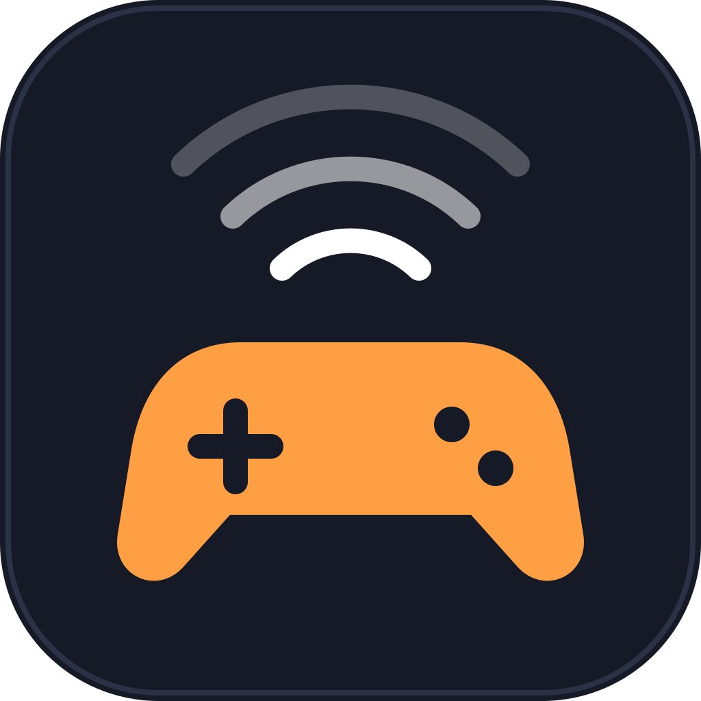

# RemoPlay

אפליקציית Remote Play לפלייסטיישן 4 ו-5: משדרת את המסך של הקונסולה למחשב או לטלפון, ומשחקים עם השלט מרחוק.
ממשק בעברית מימין לשמאל (ברירת מחדל) ובאנגלית.

## מה יש בה

- שידור ברשת הביתית ומחוץ לבית דרך חשבון PSN
- רישום קונסולה אוטומטי
- מצבי משחק: תגובה מהירה, מאוזן, איכות מרבית
- תמיכה בשלטי DualSense ו-DualShock 4
- הדרכה מובנית לחיבור ראשון ומד איכות חיבור בזמן משחק

## הורדה

הגרסאות נבנות אוטומטית בכל עדכון. נכנסים ללשונית **Actions**, בוחרים את הריצה האחרונה שהצליחה, ומורידים מ-**Artifacts**:

| פלטפורמה | קובץ |
|---|---|
| macOS (Apple Silicon) | `RemoPlay-macOS-arm64` |
| Windows 64-bit | `RemoPlay-Windows-x64-installer` או `RemoPlay-Windows-x64-portable` |
| Android | `RemoPlay-Android` |

## קרדיט ורישיון

RemoPlay מבוססת על [chiaki-ng](https://github.com/streetpea/chiaki-ng), שהיא המשך של Chiaki. כל העבודה על פרוטוקול ה-Remote Play שייכת למפתחים שלהן.
הקוד מופץ ברישיון AGPL-3.0 (ראו `COPYING`).

הפרויקט אינו קשור ל-Sony Interactive Entertainment ואינו מאושר על ידה. PlayStation, DualSense ו-DualShock הם סימני מסחר של Sony.

---

**RemoPlay** is a PlayStation 4/5 remote play client with a Hebrew (right-to-left) and English interface, based on [chiaki-ng](https://github.com/streetpea/chiaki-ng). Licensed under AGPL-3.0. Not affiliated with or endorsed by Sony Interactive Entertainment.
